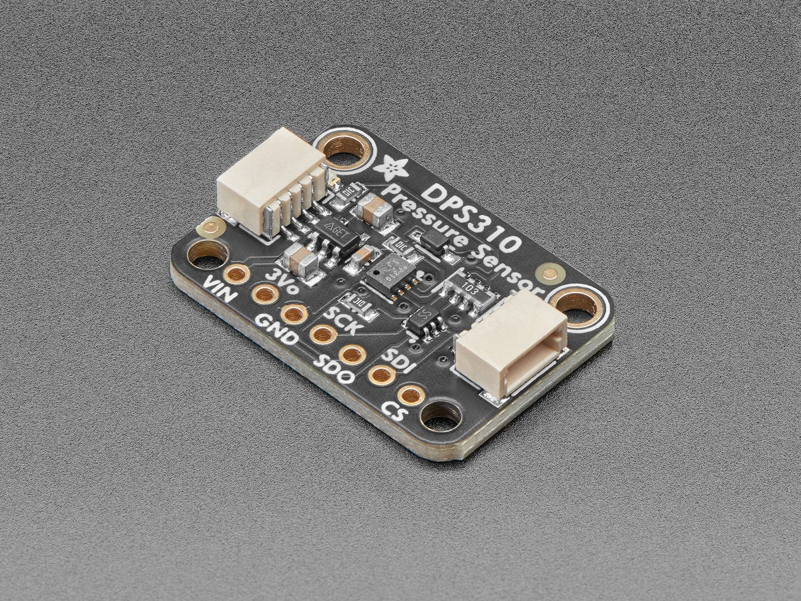

# Chip reference

[Back to README](../README.md)

Paths mentioned in this guide are relative to the repository root. Wait
times are given for both platforms: ESP-IDF at its default 100 Hz FreeRTOS
tick and at `CONFIG_FREERTOS_HZ=1000`, and the STM32 HAL's `HAL_Delay()` at
its default 1 kHz tick, which waits the same as ESP-IDF at 1000 Hz.

## BMP280

A 20-bit ADC behind a pressure die and twelve factory trim words. The cheapest
barometer that is actually good: about a metre of *relative* altitude — ±0.12
hPa, so it sees you change floors — against roughly ±8 m absolute, which is the
±1 hPa figure. `examples/*/bmp280` streams pressure, temperature and height.

| Function | Does |
|---|---|
| `bmp280_probe(&baro, bus, cfg)` | Check the chip ID, soft-reset, read the trim. `cfg` may be NULL: 0x76, ultra high resolution (and 400 kHz on ESP-IDF) |
| `bmp280_remove(&baro)` | Release the driver's state; on ESP-IDF, detach from the bus too |
| `baro_read(&baro, &s)` | One forced measurement, waited out, burst-read and compensated |

### Forced mode, and why

The BMP280 has two working modes. **Normal** free-runs at a standby interval
and you read whenever you like; **forced** takes one measurement and goes back
to sleep. This driver is forced-only:

- A read returns a sample taken *now*, not one up to a standby period old.
- Between reads the chip draws about 0.1 µA instead of tens of µA.
- The IIR filter in `config` only earns its keep on a stream of samples, and
  forced mode does not produce one, so the driver leaves `config` at the 0x00
  the reset gives it — filter off.

The cost is that `baro_read()` blocks for the whole measurement. If you want a
continuous stream at a fixed rate with the filter on, this is the wrong driver.

### Waiting it out

There is a `measuring` bit in `status`, but polling it costs a bus transfer per
attempt, so the driver just waits the datasheet maximum, rounded up to whole
milliseconds:

```
t_max = 1.25 + 2.3 * osrs_t + (2.3 * osrs_p + 0.575)   ms
```

On ESP-IDF that is where it quietly goes wrong. At the default 100 Hz tick,
`pdMS_TO_TICKS(7)` is **0**, so a plain `vTaskDelay` does not wait at all. On
top of that, `vTaskDelay(n)` can return after n − 1 ticks. Every wait in the
ESP-IDF port rounds up to a whole tick and adds one. `HAL_Delay(n)` waits n to
n + 1 ms at the HAL's default 1 kHz tick. So the real wait is:

| `enum bmp280_osr` | p / t | datasheet max | ESP-IDF, 100 Hz | ESP-IDF 1000 Hz, HAL 1 kHz |
|---|---|---|---|---|
| `ULTRA_HIGH` (default) | ×16 / ×2 | 43.2 ms | 50–60 ms | 44–45 ms |
| `HIGH` | ×8 / ×1 | 22.5 ms | 30–40 ms | 23–24 ms |
| `STANDARD` | ×4 / ×1 | 13.3 ms | 20–30 ms | 14–15 ms |
| `LOW` | ×2 / ×1 | 8.7 ms | 10–20 ms | 9–10 ms |
| `ULTRA_LOW` | ×1 / ×1 | 6.4 ms | 10–20 ms | 7–8 ms |

On ESP-IDF a lower osr only buys you speed with `CONFIG_FREERTOS_HZ=1000`.
The fake chips in `test/esp/test_bmp280.c` and `test/stm/test_bmp280.c`
credit only the guaranteed n − 1 ticks or n milliseconds and charge the
unrounded datasheet maximum, so they fail any wait that rounds down.

### The BME280 is the same chip with humidity

Same package, same addresses, the same `dig_T1..T3` and `dig_P1..P9` at
0x88..0x9F, the same pressure and temperature compensation. It only *adds*:
`dig_H1` at 0xA1, `dig_H2..H6` at 0xE1..0xE7, `ctrl_hum` at 0xF2 and humidity at
0xFD..0xFE. So a BME280 would read correct pressure and temperature through this
driver — it is rejected because the driver only claims the BMP280 and nothing
about the BME280 has been checked, not because the numbers would be wrong.

| id | part |
|---|---|
| 0x58 | BMP280 — accepted. Pre-production samples are reported to read 0x56/0x57 and are not accepted |
| 0x60 | BME280 — rejected with `-ENODEV` and a log line naming it |

### The compensation

Twelve trim words and two 20-bit raw readings, burst-read together from 0xF7
so they cannot come from different measurements. The arithmetic is the
datasheet's integer reference: `bmp280_compensate_T_int32` produces 0.01 °C
and `t_fine`, which `bmp280_compensate_P_int64` then needs, and pressure comes
out in Q24.8 pascal.

Two deliberate departures from the listing as printed, both in
[`src/bmp280/bmp280_math.h`](../src/bmp280/bmp280_math.h):

- **Left shifts of possibly-negative values are written as multiplications.**
  `var1` goes negative below roughly 25 °C, and shifting a negative value left
  is undefined in C11. Same numbers, defined behaviour.
- **A negative compensated pressure returns 0 instead of wrapping.** The
  listing casts the final `int64_t` to `uint32_t`; a raw value far outside the
  part's 300–1100 hPa range makes that value negative, and the cast turns it
  into about 16 MPa. `baro_read()` reports 0 as `-ERANGE`.

The datasheet's own `if (var1 == 0) return 0;` is kept as it stands — that is
the divide-by-zero guard, and `dig_P1 = 0` is what walks into it.
`bmp280_probe()` refuses that trim set up front as well.

One ceiling inherited from the listing and left in place: `(p << 31 - var2) *
3125` has about 1.3× headroom in `int64_t` at `adc_P = 0`, so a trim image that
drove `var2` below about −7e14 at `adc_P = 0` would overflow it. A live part
cannot produce that — `test_corners()` in `test/test_bmp280_math.c` walks the
corners of the 20-bit range against the test trim set — but an all-zeros bus
read against an extreme trim image is the shape of input that would.

### What is not here

- **SPI** (CSB low). I2C only.
- **Normal mode, the IIR filter, the standby interval.** Forced only.
- **The BME280.** Rejected by ID.
- **Raw values or register access.** Probe, remove, `baro_read()`.

### Provenance

| Claim | Status |
|---|---|
| The two compensation paths agree | **Verified here.** `test_bmp280_math.c` runs the integer implementation against the datasheet's double-precision one over 13 795 raw pairs; worst disagreement 0.0069 °C and 0.54 Pa |
| The driver's I2C sequence, waits and error paths | **Verified here.** `test/{esp,stm}/test_bmp280.c`, against a fake BMP280 on a stubbed `i2c_master` and behind a stubbed HAL |
| Registers, bit fields, chip IDs, reset word, trim layout, measurement-time formula, both compensation listings | **From memory of the BMP280 datasheet.** No PDF here, no revision number claimed, nothing cross-checked against another implementation |
| Any numeric worked example | **Does not exist.** The BMP280 datasheet publishes no calibration set with answers next to it. The fixed vectors in `test_bmp280_math.c` are *self-generated* — this implementation's own output, pinned so a change has to be deliberate. The trim set they use is made up, with realistic magnitudes |
| Behaviour on a physical BMP280 | **Never checked** |

## BMP388

The BMP280's successor: 24-bit results, fourteen trim coefficients and a
floating-point compensation. Bosch quote ±8 Pa *relative* accuracy, about
0.66 m, and ±50 Pa absolute (Table 1). `examples/*/bmp388` streams pressure,
temperature and height.

| Function | Does |
|---|---|
| `bmp388_probe(&baro, bus, cfg)` | Check the chip ID, soft-reset, read the trim, write the oversampling. `cfg` may be NULL: 0x76, highest resolution (and 400 kHz on ESP-IDF) |
| `bmp388_remove(&baro)` | Release the driver's state; on ESP-IDF, detach from the bus too |
| `baro_read(&baro, &s)` | One forced measurement, waited out, burst-read with its error and status flags, and compensated |

Every register, bit and timing is from the Bosch datasheet,
**BST-BMP388-DS001-07, revision 1.7 (November 2020)**. The PDF is kept
locally at `docs/BMP388.pdf`; it is gitignored, so a fresh clone does not
have it — fetch it from Bosch Sensortec. Section and table numbers below are
that revision's.

### Forced mode, as the BMP280

Same reasoning as [the BMP280](#forced-mode-and-why): a read returns a sample
taken now, the chip sleeps between reads, and the IIR filter — which the
datasheet recommends with normal mode (§3.3.3) — stays bypassed, as the reset
leaves `CONFIG`. Probe writes `OSR` because it resets to ×4/×1, not to the
default preset.

`ODR` only paces normal mode, but it resets to 5 ms (`odr_sel` 0x00, §4.3.18,
Table 43), shorter than every preset but ultra low. The datasheet does not
say whether forced mode flags that as `conf_err`, so probe rules it out:
`odr_sel` 0x04, 80 ms, the smallest period above the slowest preset's
78.09 ms — written before `OSR`, so the pair is never inconsistent.

The wait is Table 22's *maximum* column, rounded up to whole milliseconds and
then through the same [waits](#waiting-it-out) as the BMP280. §3.9.2's formula
gives the typical time and is not used.

| `enum bmp388_osr` | p / t | `OSR` | datasheet max | ESP-IDF, 100 Hz | ESP-IDF 1000 Hz, HAL 1 kHz |
|---|---|---|---|---|---|
| `HIGHEST` (default) | ×32 / ×2 | 0x0D | 78.09 ms | 80–90 ms | 79–80 ms |
| `ULTRA_HIGH` | ×16 / ×2 | 0x0C | 41.89 ms | 50–60 ms | 42–43 ms |
| `HIGH` | ×8 / ×1 | 0x03 | 21.53 ms | 30–40 ms | 22–23 ms |
| `STANDARD` | ×4 / ×1 | 0x02 | 12.48 ms | 20–30 ms | 13–14 ms |
| `LOW` | ×2 / ×1 | 0x01 | 7.96 ms | 10–20 ms | 8–9 ms |
| `ULTRA_LOW` | ×1 / ×1 | 0x00 | 5.70 ms | 10–20 ms | 6–7 ms |

The pairs are Table 6's, with its recommended temperature oversampling.

### Error and status flags

A read is one burst from `ERR_REG` (0x02) through the last temperature byte
(0x09): eight bytes, so the flags and both results describe the same moment.

- **`ERR_REG`** (Table 26): any of `fatal_err`, `cmd_err`, `conf_err` fails
  the read with `-EIO` and logs the register. The last two clear on read, so
  the next read can succeed; `fatal_err` does not.
- **`STATUS`** (Table 27): `drdy_press` and `drdy_temp` must both be set. Each
  clears when one of its data registers is read, and `STATUS` comes first in
  the burst, so a clear flag means the registers still hold an older
  measurement or the 0x800000 reset value — `-EIO`, not a stale sample.
- **`cmd_rdy`** (Table 27) is polled before the soft reset in probe, the only
  command the driver sends, until more than 10 ms have passed — a limit the
  datasheet does not give; on a healthy part the first read says ready. On
  ESP-IDF the polls are one tick apart and the 10 ms is counted in ticks; on
  the HAL they are 1 ms or more apart, timed by `HAL_GetTick()`. Never ready
  is `-ETIMEDOUT`, and no reset is sent. The reset is followed by the 2 ms
  start-up time (Table 2's `t_startup`; the datasheet gives no separate
  soft-reset time) and a check of `EVENT.por_detected` (§3.2, Table 31). That
  flag clears on read and is still set from power-up, so probe reads it once
  *before* the reset as well, or a reset that never finished would look like
  one that had.

### The BMP390 is not claimed

A BMP390 reads 0x60 from `CHIP_ID` and is described as sharing this register
map. Probe rejects it with `-ENODEV` and a log line naming it, the same policy
as the BMP280 driver's BME280: there is no BMP390 datasheet here, and nothing
about it has been checked. Accepting it would be a one-line change.

| id | part |
|---|---|
| 0x50 | BMP388 — accepted |
| 0x60 | BMP390 — rejected with `-ENODEV` and a log line naming it |

### The compensation

Fourteen coefficients from `NVM_PAR_T1` at 0x31 to `NVM_PAR_P11` at 0x45
(Table 23; 21 bytes, 16-bit words little-endian, signedness per coefficient),
scaled by §9.1 and fed to §9.2 and §9.3 in single precision as printed — the
FPU of the ESP32 and of the F4 is single precision, and the F7's does it in
hardware too. Every §9.1 divisor is a power of two, so the scaling is exact.
In [`src/bmp388/bmp388_math.h`](../src/bmp388/bmp388_math.h).

One departure: the listing stores `t_lin` in its calibration struct as a side
effect of the temperature function; here it is returned and passed to the
pressure function.

There is no divide anywhere, so a zero trim cannot crash; it reads nonsense.
Probe refuses `NVM_PAR_T1` or `NVM_PAR_P5` reading zero — the two unsigned
offsets, which no working part has at zero. That is a judgement from the
formula, not a datasheet rule.

Three slips in the datasheet itself, none of which changes the code: §9.1 says
the coefficients are in "Table 22", which is the measurement-time table — the
trim map is Table 23; §4.3.21 names 0x30..0x57 as calibration data, but
Table 23 uses 0x31..0x45; and §5.2 says CSB "is left open" for I2C, while §5.1
says it must be at VDDIO. The driver follows Table 23 and §5.1.

### What is not here

- **SPI** (CSB low). I2C only.
- **Normal mode, the IIR filter, ODR, the FIFO and interrupts.** Forced only.
- **The BMP390.** Rejected by ID.
- **Raw values or register access.** Probe, remove, `baro_read()`.

### Provenance

| Claim | Status |
|---|---|
| Registers, bit fields, chip ID, reset command, trim layout and signedness, measurement times, §9 listing | **From the datasheet**, rev 1.7, cited by section and table in `src/bmp388/bmp388_regs.h` and `bmp388_math.h` |
| Single precision costs nothing that matters | **Verified here.** `test_bmp388_math.c` runs it against a double-precision transcription of §9 over 17 338 raw pairs; worst disagreement 0.000004 °C and 0.036 Pa, against 0.085 Pa resolution |
| The driver's I2C sequence, waits and error paths | **Verified here.** `test/{esp,stm}/test_bmp388.c`, against a fake BMP388 on a stubbed `i2c_master` and behind a stubbed HAL |
| Any numeric worked example | **Does not exist.** The datasheet publishes no trim set with answers next to it. The fixed vectors in `test_bmp388_math.c` are *self-generated*; the trim set is made up, with realistic magnitudes |
| `por_detected` really distinguishes a finished soft reset; `drdy_*` really set in forced mode | **Read from the datasheet, never seen on silicon** |
| Behaviour on a physical BMP388 | **Never checked** |

## DPS310

<p align="center">
  
  <br><sub>Adafruit DPS310 breakout &mdash; photo <a href="https://www.adafruit.com/product/4494">Adafruit Industries</a></sub>
</p>

Relative precision around ±0.002 hPa — close enough to see a couple of
centimetres of height change, which is why it ends up on drones. The part
measures in the background at the rate you configure; `baro_read()` reads the
latest result. `examples/*/dps310` polls `dps310_data_ready()` and streams
pressure, temperature and height.

| Function | Does |
|---|---|
| `dps310_probe(&baro, bus, &cfg)` | Probe, reset, wait for ready, apply the erratum fix, read calibration, start. `cfg` is required |
| `dps310_remove(&baro)` | Put the chip idle and release it |
| `baro_read(&baro, &s)` | Compensated pressure and temperature, one burst |
| `dps310_read_raw(&baro, &p, &t)` | The two 24-bit results, uncompensated |
| `dps310_data_ready(&baro, &b)` | Both results waiting |
| `dps310_coefficients(&baro, k)` | The nine factory coefficients, if you want to do it yourself |
| `dps310_reg_read` / `_reg_write` | Anything not modelled |

```c
struct dps310_config cfg = {
	.pressure_rate    = DPS310_RATE_8,
	.pressure_osr     = DPS310_OSR_64,   /* resolution comes from here */
	.temperature_rate = DPS310_RATE_8,
	.temperature_osr  = DPS310_OSR_8,
};
```

### The one-second budget

Background mode has one second to fit every measurement it was asked for,
pressure and temperature together. One measurement takes 2.0 ms plus 1.6 ms
per oversample — 3.6 ms at 1× up to 206.8 ms at 128× — times the rate.
**`dps310_probe()` refuses a config that needs 990 ms or more of every
second** with `-EINVAL`, before touching the chip, and logs the sum. The
config above is 953.6 ms and fits; 64× pressure at 16 Hz is 1712 ms and does
not. The formula and the 10 ms margin are Infineon's own
(arduino-xensiv-dps3xx `calcBusyTime()`, `DPS3xx__MAX_BUSYTIME`).

### Five things that quietly ruin a reading

**1. The calibration is not ready when the chip is.** `MEAS_CFG` has separate
`SENSOR_RDY` and `COEF_RDY` bits, and reading the coefficients before the
latter returns zeros. Probe waits for both, up to 250 ms, with the last read
at or after the deadline, and returns `-ETIMEDOUT` rather than continuing
with whatever it got. On ESP-IDF the 250 ms is **counted in ticks**, polling
at least one tick apart: counting polls instead fails at the default 100 Hz
tick, where a 5 ms poll is 0 ticks and fifty of them take no time at all. On
the HAL the polls are 5 ms or more apart, timed by `HAL_GetTick()`.

**2. There are two internal temperature sensors, and the calibration only
matches one of them.** `COEF_SRCE` bit 7 says which. Measure with the other
and the temperature is wrong — and since the pressure polynomial has
temperature terms in it, **the pressure is wrong too**. The driver copies that
bit into `TMP_CFG`.

**3. Above 8× oversampling the result comes back shifted**, and `CFG_REG` has
to be told. The pressure shift is **bit 2 (0x04)**, the temperature shift bit
3 — Linux's driver has them at bits 4 and 5, inside `INT_SEL`, which is wrong.
The scale-factor table is *not* monotonic for the same reason — 16× has a
smaller divisor than 8× — so it looks like a typo and is not.

**4. Some parts read ~60 °C when it is ~20 °C.** There is a manufacturer
workaround using undocumented registers; both reference drivers carry it.
Probe reads `0x32`, and if bit 1 is clear plays the five-write sequence. You
will see `applying the temperature erratum fix` in the log when it happens.

**5. The one-second budget above.** Over it, the part cannot finish its
measurements and the rate you asked for is not the rate you get.

### The compensation

Nine factory coefficients, packed into eighteen bytes at widths of 12, 12, 20,
20 and 16 bits — three of which straddle a nibble boundary. Then:

```
T = c0*0.5 + c1*Traw_sc
P = c00 + Praw_sc*(c10 + Praw_sc*(c20 + Praw_sc*c30))
        + Traw_sc*c01 + Traw_sc*Praw_sc*(c11 + Praw_sc*c21)
```

Get one sign extension wrong and the pressure is stable, plausible, and tens
of hectopascal out. So `test_dps310_math.c` checks the unpacking against
hand-computed patterns — all-zeros, all-ones, a distinct value per field, and
the two bytes where adjacent coefficients share a nibble.

### What is not here

- **SPI.** I2C only.
- **The FIFO and interrupts.** Poll `dps310_data_ready()`; the rest is behind
  `dps310_reg_read`/`_write`.

### Provenance

Every address, bit position and constant except the `CFG_REG` bits appears in
two independent drivers that agree:

- The Linux kernel's [`drivers/iio/pressure/dps310.c`](https://github.com/torvalds/linux/blob/master/drivers/iio/pressure/dps310.c)
- Zephyr's [`drivers/sensor/infineon/dps310/`](https://github.com/zephyrproject-rtos/zephyr/tree/main/drivers/sensor/infineon/dps310)

Including the erratum sequence, which is undocumented in the datasheet but
identical in both. `CFG_REG` follows Infineon's
[arduino-xensiv-dps3xx](https://github.com/Infineon/arduino-xensiv-dps3xx),
and Adafruit_DPS310 agrees. Nothing here has been checked against a physical
chip.

## MS5611

A 24-bit ADC behind a pressure die, about 10 cm of altitude resolution at the
highest oversampling, which is why it ends up on flight controllers.
`examples/*/ms5611` streams pressure, temperature and height.

| Function | Does |
|---|---|
| `ms5611_probe(&baro, bus, cfg)` | Reset, read the PROM, check its CRC4. `cfg` may be NULL: 0x77, OSR 4096 (and 400 kHz on ESP-IDF) |
| `ms5611_remove(&baro)` | Release the driver's state; on ESP-IDF, detach from the bus too |
| `baro_read(&baro, &s)` | Convert D2 then D1, wait each out, compensate |

### Commands, not registers

The chip has no register file: every transaction is a one-byte command, and
an answer — a PROM word or the 24-bit ADC result — is read back in a separate
transaction, with a STOP between them as I2C INTERFACE draws it (Figs 11-15,
checked on the sibling MS5607-02BA03 sheet). So the driver sends the command
as a bare `transfer()` and reads the answer with the bus's `receive()`: on
ESP-IDF `i2c_master_transmit()` then `i2c_master_receive()`, on the HAL
`HAL_I2C_Master_Transmit()` then `HAL_I2C_Master_Receive()`. The other three
chips use register reads and writes.

esp-baro sent each query as one `i2c_master_transmit_receive()`, a repeated
start instead of the STOP, chosen from memory of the MS5611 sheet; that form
was dropped for the cited one.

### The gotcha: no data-ready flag

The chip never says when a conversion is done. Read the ADC too early and it
returns **0**, and 0 pushed through the compensation is a nonsense pressure
that looks like a number. So the driver waits the datasheet's *maximum*
conversion time, and treats a 0 as `-EIO` rather than compensating it.

Each wait is rounded up to whole milliseconds, then through the same
[waits](#waiting-it-out) as the BMP280; the HAL has no microsecond delay:

| OSR | datasheet max | ESP-IDF, 100 Hz | ESP-IDF 1000 Hz, HAL 1 kHz |
|---|---|---|---|
| 4096 | 9.04 ms | 10–20 ms | 10–11 ms |
| 2048 | 4.54 ms | 10–20 ms | 5–6 ms |
| 1024 | 2.28 ms | 10–20 ms | 3–4 ms |
| 512 | 1.17 ms | 10–20 ms | 2–3 ms |
| 256 | 0.60 ms | 10–20 ms | 1–2 ms |

A read does two conversions. At ESP-IDF's default tick that is 20–40 ms
**whatever the osr**; a lower osr only makes it faster with
`CONFIG_FREERTOS_HZ=1000`. On the HAL it is 20–22 ms at OSR 4096 and 2–4 ms
at OSR 256 — at 256, two to three times the 1.2 ms the chip needs. The fake
chips in `test/esp/test_ms5611.c` and `test/stm/test_ms5611.c` credit only
the guaranteed n − 1 ticks or n milliseconds and charge the unrounded
maximum, so they fail any wait that rounds down.

### The compensation

Six factory words, C1..C6, and two raw readings: D1 (pressure) and D2
(temperature). All integer maths, exactly as the datasheet gives it:

```
dT   = D2 - C5*2^8                 TEMP = 2000 + dT*C6/2^23      (0.01 °C)
OFF  = C2*2^16 + C4*dT/2^7         SENS = C1*2^15 + C3*dT/2^8
P    = (D1*SENS/2^21 - OFF)/2^15                                 (Pa)

below 20 °C:   T2 = dT^2/2^31   OFF2 = 5(TEMP-2000)^2/2    SENS2 = 5(TEMP-2000)^2/4
below -15 °C:                   OFF2 += 7(TEMP+1500)^2     SENS2 += 11(TEMP+1500)^2/2
```

`test_ms5611_math.c` checks the datasheet's worked example (TEMP 2007, P
100009) and one hand-worked case for each cold branch. Those branches only run
in the cold, so a wrong constant there stays hidden all summer. Divisions
truncate toward zero; a right shift would floor, and differs by 1 LSB on
negative values.

### The CRC is the only identity check

There is no ID register. The CRC4 over the PROM (AN520) is the only evidence
that the part answering is an MS5611 at all, so a failure is `-ENODEV`. It has
two holes:

- An all-zero PROM has a CRC of 0 and passes. Probe also rejects C1..C6 = 0.
- AN520 zeroes the whole low byte of word 7, so bits 7..4 of that word are
  not covered. `test_ms5611.c` flips every other bit of the PROM and expects
  `-ENODEV`, and pins those four as unchecked.

### What is not here

- **SPI** (PS low). I2C only.
- **MS5607 and relatives.** Same commands, same CRC, different constants. An
  MS5607 passes probe and reads roughly half the real pressure.

### Provenance

| Source | Checked |
|---|---|
| [TE MS5611-01BA03 datasheet, 06/2017](https://www.te.com/commerce/DocumentDelivery/DDEController?Action=srchrtrv&DocNm=MS5611-01BA03&DocType=Data+Sheet&DocLang=English) | worked example, second-order constants, conversion times, I2C address and CSB |
| [TE AN520 rev 004](https://www.amsys-sensor.com/downloads/notes/MS5XXX-C-code-example-for-MS56xx-MS57xx-MS58xx-AMSYS-an520e.pdf) | the CRC4 example vector (word 7 = 0x4500, CRC 0xB) |
| TE MS5607-02BA03 datasheet, DA5607-02BA03_018 — the sibling part; the MS5611 sheet was unreachable (TE: Access Denied) | command bytes, 2.8 ms PROM reload, the STOP between a command and its answer (I2C INTERFACE, Figs 11-15) |
| unchecked | other section names, pin names, the MS5607 note |

The worked example and the AN520 vector both reproduce exactly in
`test_ms5611_math.c`. Nothing has been checked against a physical chip.
